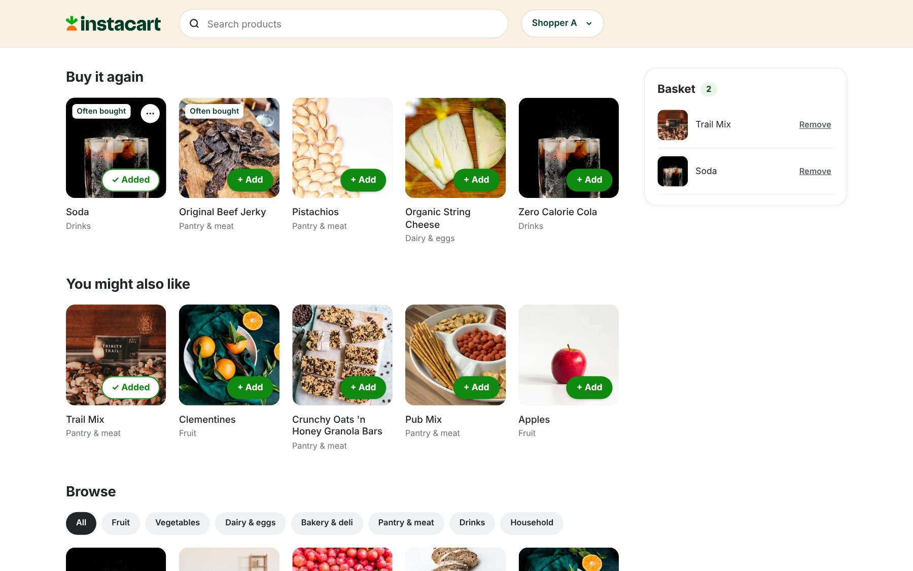

# Buy it again: evaluating a grocery recommendation feature

**Case study | Version 1 | Updated 23 October 2026**

Independent analysis and local prototype using Instacart's public 2017 order data. This project isn't commissioned by or affiliated with Instacart.

## Executive summary

**Product question:** can a short Buy it again list help returning shoppers find familiar groceries with less searching?

I compared five recommendation methods on the same **131,209 customers**, then built a local prototype around the selected method. Weighted recency achieved **24.28% mean Recall@5** on final baskets, compared with **23.12% for personal frequency** and **24.45% for boosted trees**. Recall measures how much of each later basket appeared in the suggestions, averaged across customers.

**Decision:** keep weighted recency for Version 1. It improved on personal frequency while keeping the rule straightforward to inspect. I accepted the tree model's small accuracy advantage rather than adding a fitted model to this version. The choice was made after validation, before the separate final check.

Two exploratory prototype sessions then reported shorter tasks with suggestions: about **22 → 4 seconds** and **20 → 5 seconds**. Both used search first and repeated the products. These observations are encouraging, but practice and first-session help prevent attributing the difference to the feature alone.

The completed deliverables are the checked analysis, saved results, local interactive prototype and documented pilot observations. **Recommendation: retain the current method and run a better-controlled usability round before claiming shopper benefit.** Full app timing, independent setup verification and production readiness remain open. Nothing has been deployed.

## 1. Problem, scope and decision

The target situation is a returning shopper building another grocery basket. A Buy it again area could make familiar products easier to reach. This is a hypothesis based on the proposed use case, not a finding from interviews or browsing data.

The decision was which recommendation method to use for Version 1, considering relevance, clarity, maintenance and implementation effort.

| Question | Evidence needed | Current position |
|---|---|---|
| Does personal history predict later baskets better than a general list? | Matched historical comparison | Evaluated |
| Does a learned model add enough value over a fixed rule? | Accuracy, uncertainty and operational trade-offs | Evaluated for two fixed ML attempts |
| Can people understand and use the feature? | Observed prototype tasks | Two exploratory sessions reported; limited owner checks |
| Does it reduce searching without introducing mistakes? | Controlled comparison of time, completion and errors | Preliminary timings recorded; causal benefit not established |

Version 1 includes up to five familiar products, optional Add, exact-product Hide, Undo and Show again, plus search and browsing. New-product discovery, prices, quantities, checkout, payments, real accounts and online learning are outside scope.

ML means machine learning: a model learns patterns from earlier examples. No numeric customer-benefit target was agreed before the analysis. The proposed 0.5-percentage-point recall improvement target was introduced before the tree attempt, after earlier validation work. It is an exploratory comparison criterion, not a business acceptance standard.

## 2. Data and preparation

The release contains **3,421,083 orders, 206,209 anonymous customers and 49,688 products**, organised in six linked CSVs. Each order-product row identifies a product in a purchased basket; it doesn't specify quantity.

Working copies came from a documented [Zenodo mirror](https://zenodo.org/records/2654444) of the [Instacart release](https://tech.instacart.com/3-million-instacart-orders-open-sourced-d40d29ead6f2). Published archive checks and local hashes were recorded. This documents the retrieval route; it doesn't certify identity with original publisher bytes that weren't available to retrieve.

Preparation checked table keys, duplicate product lines, missing values, links and row counts. Expected missing first-order gaps were retained; a recorded 30-day gap means 30 or more days. Source files were preserved. Unknown final test baskets weren't treated as empty orders.

Current feature preparation uses Python and SQLite. When Windows blocked DuckDB's native module, the SQLite route was checked against earlier saved personal-method scores and independent raw-record calculations. Historical DuckDB work remains available, but its old notebook cells haven't all been migrated.

The data contains no search, browsing, exposure, abandonment, prices or purchase motivations. It is a historical sample, not evidence of current Instacart performance. [Source, grain and metric reference](data_and_methods.md).

## 3. Evaluation design

### Cohort, candidates and chronology

The comparison used the 131,209 customers with known official final-basket contents. Customers with unknown official test contents weren't scored. Personal methods could choose only products bought before the relevant prediction point; popularity could suggest unfamiliar products. Candidate rules therefore differ by design.

For a customer's last prior order numbered **v**, the sequence was:

| Stage | Inputs available | Basket used as the answer |
|---|---|---|
| ML training | Orders through v−2 | Order v−1 |
| Validation | Orders through v−1 | Order v |
| Final check | All prior orders through v | Released labelled final order v+1 |

There was one ML training target per customer, producing 7,324,671 customer-product rows; validation contained 7,912,788 candidate rows. Each row described one familiar product for one customer at a prediction point. IDs weren't model inputs.

Scaling for logistic regression was learned from training only. Models and settings were frozen before final scoring. Final recommendation lists were saved and checked before final product answers were opened for scoring; no refit or re-ranking occurred afterward. Independent checks matched raw basket overlaps for 100 customers per method, with cohort, target and file-fingerprint checks passing.

This is a later-order check for known customers. It isn't a common-calendar backtest or a test of performance on entirely new customers. The final holdout is now inspected and must not be reused for tuning.

### Measures and short lists

- **Primary: mean Recall@5.** Matching suggestions divided by all distinct products in each actual target basket, then averaged across customers.
- **Supporting: mean Precision@5.** Matches divided by five, including unfilled slots, then averaged across customers.
- **Hit Rate@5.** Customers with at least one match divided by all evaluated customers.

Supporting diagnostics covered history length, basket size, coverage, individual gains/losses and local runtime. Personal methods produced 651,660 suggestions, with 2,168 customers receiving fewer than five. Short lists were retained. Popularity filled all 656,045 slots.

## 4. Methods and iteration

| Method | Implementation | Reason to test it |
|---|---|---|
| General popularity | Same five products, ranked using eligible earlier cohort orders | Establish a reference without personalisation |
| Personal frequency | Earlier order count per familiar product; recency breaks ties | Test the value of individual history |
| Weighted recency | Sum purchase points with a fixed five-order half-life | Test whether recent behaviour improves a simple rule |
| Logistic regression | Training-only scaling and L2 regularisation, C=1.0 | Learn how to combine purchase-history clues |
| Boosted trees | 100 boosting rounds, learning rate 0.1, depth up to 4 and 15 leaves | Test more flexible combinations of the same clues |

The five ML inputs were purchase count, purchase share, orders since last purchase, weighted-recency score and history length. Each learned model was one fixed attempt; there was no exhaustive setting search. No calibration test was run, and scores aren't presented as guaranteed purchase probabilities.

Weighted recency sums `0.5 ** ((history_cutoff_order - purchase_order_number) / 5)` per familiar product, rounding totals to 12 decimals. Ranking uses score, latest purchase, then product ID. The half-life uses order positions, not days, and wasn't tuned against final results.

Validation mean Recall@5 was 24.543% for weighted recency, 24.546% for logistic regression and 24.707% for trees. The tree gain of about 0.164 percentage points was below the exploratory 0.5-point target. I selected weighted recency at that stage; the final check assessed the fixed choice rather than selecting another winner.

## 5. Final results and interpretation

All methods below share the same 131,209 final targets, containing 1,384,617 product lines. These are offline prediction scores, not causal purchase or business-impact measures.

| Method | Mean Precision@5 | Mean Recall@5 | Hit Rate@5 |
|---|---:|---:|---:|
| General popularity | 9.48% | 4.69% | 36.24% |
| Personal frequency | 35.41% | 23.12% | 78.23% |
| Weighted recency — selected | 37.32% | 24.28% | 79.37% |
| Logistic regression | 37.30% | 24.28% | 79.38% |
| Boosted trees | 37.58% | 24.45% | 79.45% |

### Personal history improved relevance

Weighted recency increased mean recall over frequency by **1.160 percentage points** and over general popularity by **19.589 points**. Compared with frequency, 19,217 customers received more matches, 102,489 received the same count and 9,503 received fewer. The average improvement wasn't universal, and equal counts don't imply identical lists.

### The tree improvement was measurable but modest

| Recall comparison | Mean difference | Approximate paired 95% interval |
|---|---:|---:|
| Weighted recency vs frequency | +1.160 pp | +1.112 to +1.208 pp |
| Logistic vs weighted recency | +0.003 pp | -0.017 to +0.022 pp |
| Trees vs weighted recency | +0.176 pp | +0.148 to +0.205 pp |

“pp” means percentage points. These intervals assume independent customers; they don't resolve sample bias or establish shopper benefit. The logistic recall interval spans zero. The tree interval doesn't, so its gain shouldn't be dismissed as no difference.

Final suggested-product coverage was 28,721 distinct products for weighted recency and 28,973 for trees, from a pool of 49,468 eligible products. Broader coverage isn't automatically more useful for Buy it again. Both methods had the same number of short lists.

The matched local benchmark found weighted recency, logistic regression and boosted trees fast on prepared inputs: median scoring/ranking was about 0.005 ms for weighted recency, 0.204 ms for logistic regression and 0.541 ms for trees. This was a warm, sequential 90-customer test excluding raw-history preparation, model startup, network and browser rendering. It isn't a full-app or concurrent-load benchmark.

## 6. Recommendation and product implementation

Retain weighted recency for Version 1. Its explicit purchase contributions make it straightforward to inspect and explain, while avoiding a separate learned model and scaler. This is a judgement about the first version, not evidence that ML is unsuitable or that weighted recency maximises accuracy. I accept the measured tree advantage as the cost of this choice.

The alternatives inform that decision:

| Alternative | What the evidence showed | Version 1 decision |
|---|---|---|
| General popularity | Much lower recall; no personal history | Keep only as the separate no-history fallback |
| Personal frequency | Useful personal baseline, but lower recall than weighted recency | Keep as a benchmark |
| Logistic regression | Near-identical recall; paired interval spans zero | No clear measured gain to justify replacing the rule |
| Boosted trees | Highest recall, with a positive paired interval | Keep the result; accept the small accuracy cost of choosing the simpler rule |

Explanation and maintenance were design judgements, not measured staff-time savings. All three approaches in the local runtime comparison were fast; speed wasn't the reason to reject trees.

The implementation is a self-contained HTML prototype with saved rankings, not a production recommendation service. Two small real historical examples demonstrate full and short lists; a simulated no-history profile uses general popularity. New-customer effectiveness wasn't measured. Photos are illustrative, and profile selection isn't a real account.

*Prototype captured on 24 October 2026, after the discovery row was added. Shopper A has added Trail Mix and Soda. This illustrates the interface, not measured shopping benefit.*

Hide filters one exact product before selecting the top five; the next candidate fills the gap when available. Show again restores eligibility, not a guaranteed rank. Hidden state stays per example shopper in the same browser. Skipping or hiding isn't used to retrain the model, and Hide doesn't remove products already in the basket.

Interface iterations simplified the shopper selector, basket wording and Hide action, and removed analysis explanations from the shopping screen. Those choices preserve the feature's focus; their effect on usability hasn't been established through a structured comparative test.

## 7. Prototype pilot and release readiness

### What the two sessions showed

Justin facilitated the sessions and supplied the transcript, approximate timings and later clarifications. Both participants used search first, then suggestions for the same products. They acted as an example shopper; these weren't their own recommendation histories. The table records reported observations rather than independently observed screen recordings.

| Participant | Search first | Suggestions second | Help and outcome |
|---|---:|---:|---|
| R01 | About 22 seconds | About 4 seconds | Naming clarification and moderator help during search; exact final baskets weren't verified. Preferred the second version. |
| R02 | About 20 seconds | About 5 seconds | No help reported; both correct target products were in the basket after each task. |

**Interpretation:** both second tasks were reported faster. R02 also shows that one person could add the intended products without help. This is an early signal that a visible, relevant shortlist may be useful.

**Limits:** the same-product repetition and fixed condition order introduce practice effects. R01's first task also included help and a mismatch between the requested “zero sugar soda” and catalogue name “Zero Calorie Cola.” R02's exact product names, basket reset, extras/corrected wrong additions and preference weren't recorded. Correct target products being present doesn't establish zero errors. No representative recruitment or controlled task timing was documented.

These records don't support a claimed percentage time reduction, a population completion rate or an estimate of real shopping benefit. They also don't validate recommendation quality for these participants: the tasks named products already in the example shortlist. Earlier owner feedback about finding Hide on the no-history profile is retained separately in the research record.

### Next product decision

Keep the current version for a more controlled round rather than changing the model from these observations. Give people exact catalogue names, use different but comparable product sets, vary which condition comes first and start each task with an empty basket. Record intended products, start/end events, completion, wrong additions, abandonment and help alongside time. Agree participant selection, sample size and acceptance criteria before that round. A small usability pilot can expose confusion; establishing a general benefit needs stronger evidence.

### What is finished, and what remains

| Area | Completed evidence | Still open |
|---|---|---|
| Recommendation choice | Five methods compared; weighted recency selected before final scoring; final evidence retained | Fresh data for any later tuning; no reuse of the inspected holdout |
| Product behaviour | Local prototype, interaction logic checks and an actual desktop screenshot | Remaining responsive sizes, all keyboard controls and loading/error states |
| Basic usability | Two exploratory sessions; owner-reported narrow-window and basic keyboard checks | Controlled comparison and fuller accessibility review |
| Setup and performance | Local dependency/link review; separate warm scoring benchmark | Independent setup reproduction and full app response measurement |
| Release | Sources, image credits and local-data boundaries documented | Review example-data/asset usage and prepare hosting; nothing deployed |

The setup review matched all 100 pinned package versions and found no dependency conflicts on the existing machine. It wasn't a fresh installation. The desktop screenshot and owner checks don't constitute a physical-phone test or an accessibility audit.

### Risks to carry forward

| Risk | Current response | Remaining check |
|---|---|---|
| Preferences change | Fixed recency weighting; optional Add and reversible Hide | Evaluate against fresh histories before changing the rule |
| Familiar-only lists miss discovery purchases | Preserve browsing/search; no discovery filler | Treat discovery as a separate product question |
| Sparse histories produce short lists | Show fewer products; separate no-history fallback | Check whether people understand each state |
| Faster time hides giving up or mistakes | Examine completion and errors with timing | Define and observe these consistently in the next round |

No revenue, retention or conversion impact is claimed. The current evidence supports a documented prototype and a reasoned first-version choice, not production readiness or proven search-time savings.

## 8. Project review and authorship

The key lesson was separating a better basket prediction from a better shopping experience. Three decisions shaped the work:

- Start with simple baselines so a learned model has a useful comparison.
- Separate earlier inputs from later answers, and fix the method before inspecting the final check.
- Recognise a real but small accuracy gain, then explain why the first version prioritises an inspectable rule.

The pilot added another lesson: a faster second task can reflect learning as well as design. Recording assistance and task order matters as much as recording seconds. Remaining learning and test gaps are kept visible rather than treated as completed work.

Justin chose the product scope and first-version direction, reviewed the comparisons and iterated on the interface. Codex assisted with SQL, Python, checking, explanations and implementation; Claude assisted with prototype design. The decision and learning records describe that collaboration.

## 9. Follow-up experiment: purchase timing

After completing Version 1, I tested whether a familiar product's usual purchase gap could improve the selected rule. The challenger added a bounded timing bonus to weighted recency, using only earlier purchases. Products with fewer than three earlier purchases kept the baseline score. Gaps were measured in order positions, not days or quantities consumed. This was one fixed rule, with no model fit or settings search.

The experiment used a separate cohort from the existing dataset: 60,000 development customers and 15,000 reserved for a conditional audit. The target was each customer's last known prior basket; unknown official test baskets remained unknown. These customers weren't in the Version 1 evaluated cohort, but the source data had already been loaded and summarised. This wasn't newly collected or guaranteed pristine unseen data.

| Development measure | Weighted recency | Timing rule |
|---|---:|---:|
| Mean Precision@5 | 37.302% | 37.374% |
| Mean Recall@5 | 24.556% | 24.581% |
| Hit Rate@5 | 79.560% | 79.557% |

Both methods used the same 60,000 customers and target baskets. These scores shouldn't be compared directly with Version 1's final scores, which use a different cohort and target point.

The recall gain was **0.025 percentage points**, with an approximate paired 95% interval of **-0.003 to +0.052 points**, assuming independent customers. It fell below the 0.25-point improvement criterion fixed before this attempt's results; the interval also included zero. The criterion was an agent-proposed exploratory project choice, not an agreed business target or industry standard.

**Decision: stop this timing attempt and retain weighted recency.** The reserved 15,000-customer audit wasn't scored. I didn't change the prototype or move the adoption threshold after seeing the result. This shows that this particular timing rule didn't establish enough added value; it doesn't rule out other timing methods.

The learning project now closes with checked analysis, a working local prototype and a documented decision. Stronger customer-benefit testing and production release remain future work. The useful outcome wasn't another feature: it was evidence for keeping the current one simpler.

Evidence: [fixed timing protocol](../results/v2_timing_protocol.json), preparation checks, and [development comparison](../results/v2_timing_development.json).

## 10. Version 3: reserved discovery check — complete

23 October 2026. After reviewing development results, Justin authorised the reserved check. We wrote a separate audit protocol before reading its target products. We reused the exact development-fitted product relationships and popularity ranking; audit shoppers supplied only their own earlier history for personalisation. No model was refitted and no settings changed.

Both methods' 45,000 suggestions were saved and fingerprinted before opening audit product answers. The targets were the last known prior baskets for the fixed 15,000 reserved shoppers, not their unknown official final test baskets.

| Audit measure | Unfamiliar popularity | Related products |
|---|---:|---:|
| Hit Rate@3 — all 15,000 shoppers | 6.627% | 7.727% |
| Mean Precision@3 — all 15,000 shoppers | 2.351% | 2.738% |
| Mean novel-product Recall@3 — 12,253 shoppers with novel target products | 1.786% | 2.197% |
| Distinct suggested products | 25 | 1,444 |

The hit-rate gain was **1.100 percentage points**, with an approximate paired 95% interval of **+0.693 to +1.507 points**. Precision also improved. It passed the unchanged project gate: at least +0.5 hit-rate points, a positive interval lower bound and no precision loss. These are exploratory project criteria, not an industry standard or a business-benefit threshold.

Compared with popularity, 569 shoppers gained a hit, 404 lost a hit and 14,027 had the same hit/no-hit outcome: a net 165 more shoppers with at least one match. Same hit status doesn't imply identical products or match counts. Most shoppers still received no matching discovery product.

The 2,747 shoppers with no novel target products remained in hit-rate and precision denominators. Novel recall used the other 12,253 only. Of 63,830 novel target product lines, 63,728 appeared in the development-history catalogue; the unavailable products stayed in the recall denominator. All lists had three items. The related method used 18 popularity-fill slots out of 45,000.

Checks independently rebuilt rankings for 100 sampled shoppers before scoring, re-read source CSV answers and matches for 100 after scoring, and verified all recommendations excluded personal history and used the exact audit cohort. Model, code, protocol, source-history and prediction fingerprints remained unchanged. No V1/V2 model or shopping UI was changed.

**Conclusion:** the related-product method beat unfamiliar popularity in both development and this reserved retrospective check. That supports a discovery prototype experiment; it doesn't establish that recommendations cause purchases, satisfaction or useful exploration. Shared historical data lacks common calendar dates, the source had previously been loaded/summarised, and the interval assumes independent shoppers conditional on the frozen shared statistics. Don't describe this as new live data or perfectly pristine original-source validation.

**The audit is now exposed.** Don't tune against it or call a rerun a fresh test. V2 timing remains stopped and was never audit-scored; this was a separately authorised discovery check. Next: discuss a separate “You might also like” prototype section and discovery-specific user tasks. No discovery UI has been built or released yet.

Evidence: [audit protocol](../results/discovery_audit_protocol.json), saved-prediction checks, [audit results](../results/discovery_audit.json).

## Evidence and reporting references

Project evidence: [final evaluation](../results/final_evaluation.json), [runtime benchmark](../results/prediction_runtime.json), feature checks, findings, [decision log](decision_log.md), [research record](research_and_testing.md), [source/method reference](data_and_methods.md), [prototype walkthrough](../README.md), local setup review, and image/brand sources.

This report's structure was revised using [Microsoft's data-science lifecycle guidance](https://learn.microsoft.com/en-us/shows/dev-intro-to-data-science/what-is-the-data-science-lifecycle-2-of-28) and [Nielsen Norman Group's guidance on reporting findings](https://www.nngroup.com/articles/complex-data-compelling-stories/): connect the problem, data, modelling and acceptance decisions; lead with conclusions supported by evidence; and retain findings that complicate the recommendation. This is reporting guidance, not a claim of formal certification or completed deployment.

## Subsequent prototype scope update — 24 October 2026

At Justin's request, the illustrative A/B discovery section now displays five items from the same fixed ranking, with embedded product photos. The reported discovery comparisons above evaluated three suggestions and remain labelled @3. No five-item evaluation was run, and the exposed audit wasn't reused as a fresh test. This presentation change needs visual review and discovery-specific usability testing. A/B share three of five suggestions through overlapping shared-buyer connections; B has only one familiar product, limiting its personal evidence. No claim of distinct tastes or useful discovery follows from these examples alone.
